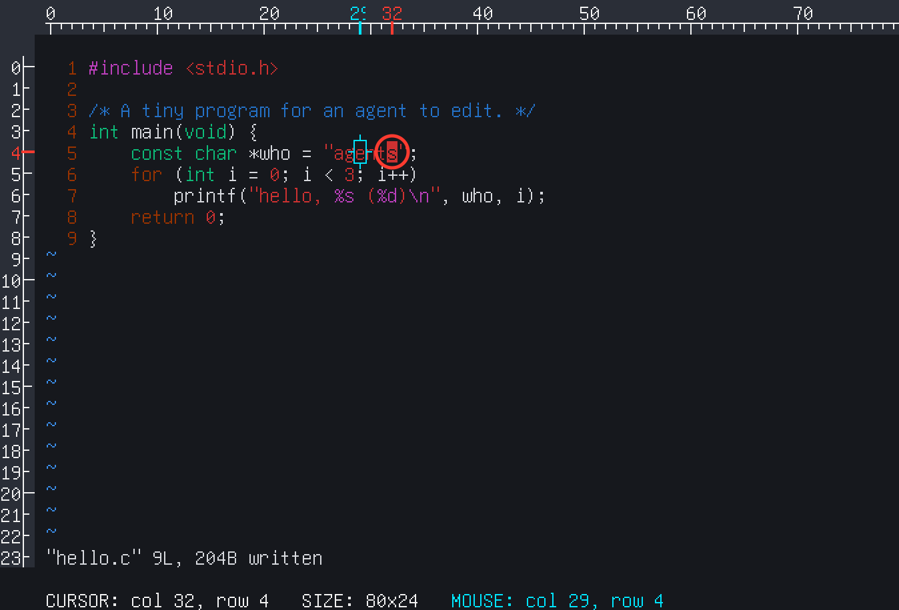

# callbox — Playwright for the terminal

**The agent TUI tester: see, drive, and test terminal programs from scripts
and AI agents.** callbox runs any command on its own headless terminal. Read its
screen as text, JSON, or a color screenshot; type keys, paste, and click; wait
for it to settle; and let AI coding agents message each other. One binary
with no runtime dependencies (static on Linux). No daemon.

[](https://github.com/RchGrav/callbox/actions/workflows/ci.yml)
[](https://github.com/RchGrav/callbox/actions/workflows/release.yml)
[](https://github.com/RchGrav/callbox/releases/latest)
[](https://github.com/RchGrav/callbox/releases)
[](LICENSE)
[](https://github.com/RchGrav/callbox/stargazers)


[](docs/guide.md#give-your-agent-callbox)



*vim driven with `callbox send` and `callbox peek` alone: a click inside
`"world"` (cyan), the word replaced, the file saved. The rulers give exact
coordinates; the red marks and the ring (`--cursor-ring`) show the cursor.*

```sh
callbox -dt --name app -- vim notes.txt   # run any TUI on its own headless terminal
callbox wait app --idle                   # until it has drawn its first screen
callbox peek app                          # its screen, as plain text
callbox peek app --image app.png          # ...or as a color PNG with coordinate rulers
callbox send app i "hello" -k Escape :wq --enter   # type, press keys, in order
callbox wait app                          # until it exits; prints the exit code
```

What Playwright does for web pages, callbox does for terminal programs — and
unlike `tmux send-keys` and `capture-pane`, it was built for automation: no
session to manage, exact key encoding, waits instead of sleeps, and
screenshots an agent can actually read.

## Install

```sh
curl -LsSf https://github.com/RchGrav/callbox/releases/latest/download/install.sh | sh
```

Linux (x86_64, arm64, armhf, riscv64, mipsel) and macOS; on Windows, use
WSL. System-wide installs, checksums, and building from source:
[docs/install.md](docs/install.md).

## Try it

**Drive a terminal app.** Start it on a headless terminal, then read and
type into it:

```sh
callbox -dt --name mon -- htop
callbox peek mon                  # its screen, as text
callbox send mon -k F6            # press a key (htop: sort by)
callbox peek mon --image mon.png  # ...or look at it
callbox end mon
```

**Let two agents talk.** Start one with `-it` and work with it; it can
start another and message it, and the reply is typed back into its prompt:

```sh
callbox -it --name lead claude
# then, from lead:
callbox -dt --name reviewer codex
callbox msg reviewer "review src/main.c"
```

**Keep something running.** A background process with a name and a log,
that you can stop and start again:

```sh
callbox -d --name web python3 -m http.server 8000
callbox logs web -f               # follow its output
callbox end web                   # stop it
callbox web                       # start it again, as before
```

## Learn more

`callbox help` lists the commands by what they are for. Five guides walk
through a task with examples, and five reference pages hold the details:

| Guides: `callbox help ...` | |
| --- | --- |
| `tui` | troubleshoot a terminal app |
| `share` | fix a terminal app with your agent, on one screen |
| `agents` | start an agent and give it work |
| `messaging` | message agents, inside or outside callbox |
| `service` | run a service or a job in the background |

| Reference: `callbox help ...` | |
| --- | --- |
| `all` | every command and flag |
| `launch` | every flag for starting a call |
| `targets` | names, ids, and the start of either |
| `scripting` | exit codes, stdout, and stderr |
| `system` | root, sudo, and the global store |

`callbox <command> -h` shows one command in full. The pages are plain text
in [src/cli/help](src/cli/help), compiled into the binary.

In depth: [the full guide](docs/guide.md) (screenshots, keys and mouse,
waiting, CI, comparisons, FAQ), [docs index](docs/index.md),
[contributing](CONTRIBUTING.md), and the [changelog](CHANGELOG.md).

## License

Apache-2.0. See [LICENSE](LICENSE).
