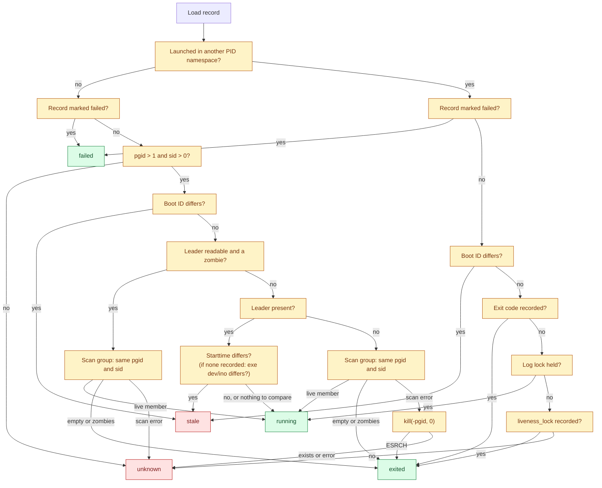

# Identity and validation

[Docs index](index.md) | [Previous: Store](store.md) | Related: [Launcher](launcher.md), [callbox identity](callbox-identity.md)

Callbox records process identity at launch and checks it again before any risky action. That is why `callbox end <call>` is safer than `kill $PID`: a call ID or name selects a record, and the record must still match the live process table before Callbox sends a signal.

If the evidence is stale or inconclusive, Callbox refuses. The refusal protects you; it is not a failure being hidden.

## Recorded identity

A record stores:

- `pid`: the program's process. With `--restart`, the restart supervisor.
- `pgid`: the process group to signal.
- `sid`: the session the program's process created with `setsid`.
- `boot_id`: a boot marker, when one can be read.
- `proc_starttime_ticks`: the process start time, or 0 when it could not be read. On Linux it is the starttime field of `/proc/<pid>/stat`, in clock ticks. On macOS it is `p_starttime`, in microseconds.
- `exe_dev` and `exe_ino`: the device and inode of the executable, or 0 when they could not be read.
- `pid_ns`: the PID namespace the call was launched in (Linux; 0 means unknown).
- `liveness_lock`: whether the call's supervisor holds a lock on the log for the call's whole life.

On Linux the probes read `/proc/<pid>/stat`, `/proc/<pid>/exe`, `/proc/self/ns/pid`, and `/proc/sys/kernel/random/boot_id`. macOS has no `/proc`, so start time and executable come from `sysctl(KERN_PROC_PID)` and `proc_pidpath`, and the boot marker is built from `kern.boottime` as `macos-<sec>.<usec>`.

A probe can fail: the process may already be gone, permission may be denied, or the platform may lack the source. A failed probe is recorded as absent, never guessed. Checks use the identity values that exist.

## State evaluation

`hold_eval_state` computes a call's state from its record and the live process table each time a command asks. Nothing stores the result. The record's `state` field holds only what the launcher (`running`) or an exit stamp (`exited`) wrote.

Notes on the diagram:

- **Boot check:** applies only when the record has a boot ID and the current boot ID can be read.
- **Marked failed:** means `state: failed` or a `launch_error` in the record. Callbox does not write either; the evaluator still honors them.
- **Leader present:** the leader's stat is readable and it is not a zombie, or `kill(pid, 0)` succeeds or fails with `EPERM`.

**Zombie leader.** A zombie leader is not automatically done. The process-group leader can exit while useful descendants remain, which is common with launchers and shell wrappers. If live members of the same group and session remain, the call is running; if the group is empty or holds only zombies, it has exited.

**Another PID namespace.** Some sandboxes give each shell its own PID namespace. There the recorded pid means nothing, and may even name an unrelated process, so it is never consulted. The filesystem is shared, and `flock` locks are held in the kernel, so a lock on the log can still show that the call is alive.

These processes hold the lifetime lock: the waiter or restart supervisor of a call started under the console fallback (Unix sockets denied, or `CALLBOX_CONSOLE_TRANSPORT=fifo`), and a TTY broker whose endpoint is a FIFO. These calls record `liveness_lock: true`, so a lock that is gone proves the call ended.

A plain `-d` call under the fallback has no supervisor. Its program's output descriptors hold a shared lock instead. A held lock shows the call runs; a missing lock proves nothing, because a program may close its output.

## What each state allows

Purge uses these states. Signaling checks the live process itself (below); the signal column shows the usual outcome.

| State | Signal (`end`, `kill`) | Purge |
|---|---|---|
| running | yes, after validation | only with `--force`, which ends it first |
| exited, failed | nothing to signal: reported as already exited | yes |
| stale | refused | yes |
| unknown | refused | only with `--force` |

## Signal safety

`signal_one` (src/runtime/signal.c) loads the record. If the call runs in another PID namespace:

- A TTY call is signaled through its broker, which can see its program.
- A `-d` call has no broker to ask, so it is refused (exit 3).
- `--print` is refused (exit 3), because the pid means nothing in this shell.

Otherwise `validate_signal_target` checks the live process before any signal:

1. If `pgid` ≤ 1 or `sid` ≤ 0, refuse (exit 5).
2. If the boot ID changed, refuse (exit 2).
3. If the leader is alive and not a zombie, its recorded starttime must match (or, when no starttime was recorded, its executable device and inode), and its current group and session must match the record. Otherwise refuse (exit 2).
4. If the leader is gone, the group is checked:
   - live members in the recorded group and session: proceed
   - empty or zombies only: the call has already exited
   - the table cannot be scanned: refuse (exit 2)
5. Where step 3 or 4 would proceed, a record with no identity value at all (no starttime, no executable identity) is refused (exit 2).

When the leader is gone but the group lives, nothing is left to compare the recorded identity against, and a process group cannot be checked and signaled in one atomic step. Matching the recorded `pgid` and `sid` within the same boot is the best available check.

Callbox then sends the signal to the whole group with `kill(-pgid, sig)`. `ESRCH` means the call already exited; `EPERM` gives exit 3.

**`end`** (alias `stop`) escalates in steps:

1. Send `SIGTERM`.
2. Poll every 25 ms, for up to 5 seconds (`STOP_TIMEOUT_MS`), until the group is gone.
3. If it remains, validate again and send `SIGKILL`.
4. Wait up to 1 second more. A group that still remains gives exit 4.

**`kill`** sends `SIGKILL` at once and does not wait.

Afterwards, `hold_report_session_escapees` warns about processes still in the session but outside the group.

**`--print`** runs the same validation and also requires the call to be live. It then prints `kill -TERM -- -<pgid>` or `kill -KILL -- -<pgid>` and signals nothing. Nothing is printed for a call that is stale, cannot be validated, has already exited, or runs in another PID namespace.

## Why this design works

PID reuse is the core hazard. Callbox has no daemon to keep live state, so it records identity at launch and combines it with live probes before every signal. When the machine state is ambiguous, refusing is the safe result.

## Implementation map

`hold_eval_state`, `eval_local_state`, `supervisor_holds_log`, `hold_call_elsewhere`, `hold_report_session_escapees`, `hold_wait_target_group_gone` (src/runtime/state.c); `hold_read_proc_stat_tokens`, `hold_read_proc_exe`, `hold_leader_present`, `hold_group_exists`, `hold_group_session_liveness`, `hold_count_session_escapees`, `hold_current_pid_ns` (src/platform/process.c); `hold_current_boot_id`, `hold_boot_id_or_null` (src/platform/boot.c); `validate_signal_target`, `signal_through_broker`, `signal_one`, `hold_cmd_signal_action` (src/runtime/signal.c).

## Continue

[Back to docs index](index.md) | [Top](#identity-and-validation) | Branch to: [Launcher](launcher.md), [Store](store.md)
