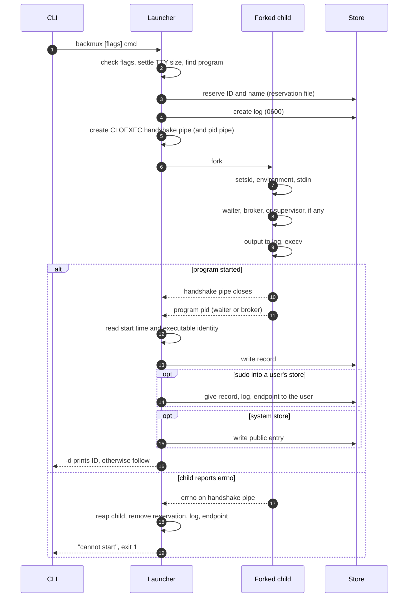
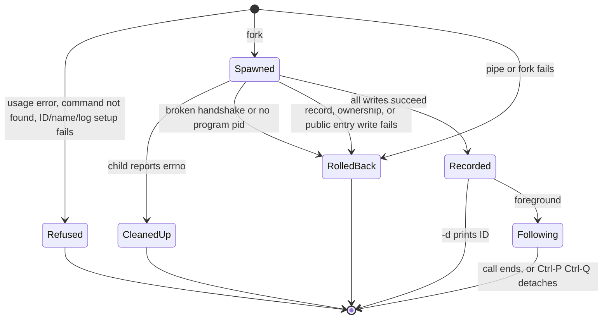

# Launcher

[Docs index](index.md) | [Previous: Index](index.md) | [Next: Store](store.md) | Related: [Identity](identity.md), [Console](console.md)

`backmux [flags] <cmd> [args...]` places a call. The launcher reserves a call ID, creates the log, forks, confirms the program started, and writes the record. Then it either prints the ID and returns (`-d`) or stays in the foreground.

Every call runs in its own session, so it outlives the shell that started it either way. `-d` decides only whether backmux returns at once.

## Output

- **`-d`:** prints the bare 64-hex call ID on stdout and nothing else; the call's name follows on stderr (`name: linked_lizard`), unless `--quiet`. Why: it is the name `msg`, `peek` and `attach` take, and with other calls running nothing else told you which was yours.
- **No session flags:** user mode. The program runs on a PTY and backmux attaches to its screen, with the chat window when stdin and stdout are a terminal (messages for the call go there, never into the program; `backmux send` still types into it). From a script, the run's output arrives as a stream instead of a screen. backmux exits with the call's exit status.
- **`-it`:** the same attached PTY without the chat window: a message for the call is typed into the program, as for any call. Why: a program run with `-it` (an agent, say) must get its messages; the window is for the switchless launch and `backmux shell`.
- **`-i` (no `-t`):** the program runs on pipes under a broker that relays your input, so it never holds your terminal. backmux shows its output, edits each typed line itself, and turns Ctrl-D into end of input. Piped input streams in and ends with EOF.
- **Foreground plain call (`-w`, `--restart`, `--tail <cmd>`):** prints nothing of its own; it follows the log, then exits with the call's exit status.
- **Keys, in every mode you are on a call:** Ctrl-C goes to the program; Ctrl-P Ctrl-Q detaches and leaves it running, with a note saying how to pick it up again.

This is `docker run`'s output dialect ([Docker parity](docker-familiarity-contract.md)).

## The program

Backmux looks the program up on `PATH` and runs it with `execv`. It never wraps the command in a shell, so a missing command fails before anything is created. Shell snippets go through `backmux -- sh -c '…'`.

The path is made absolute, but symlinks are not resolved, because a venv's python or a multi-call binary finds its environment through the name it was run under. Arguments that name existing paths are also made absolute. The record keeps the argv as typed in `observed.argv` ([Store](store.md)).

The environment:

- Every call gets `BACKMUX_ID`, and `BACKMUX_NAME` when it has a name. A call placed from inside another call also gets `BACKMUX_PARENT`, so a worker can reply to the agent that started it.
- A TTY call runs on backmux's own terminal, so it gets `TERM=xterm-256color`, and `TMUX`, `TMUX_PANE`, `STY`, `WINDOW`, `TERM_PROGRAM`, and `TERM_PROGRAM_VERSION` are removed. Otherwise a program that sees `TMUX` would act on the launcher's tmux. `-e` values are applied after this, so they win.
- A root call in the system store starts from an empty environment with a fixed `PATH`.
- Under sudo, the program starts in `/`. The launch is refused if `/` is not root-owned or is group- or world-writable.

## Who supervises the call

| Start | Process left with the program | Exit code recorded |
|---|---|---|
| `-d` | none | no |
| `-w`, `--rm`, a plain foreground call (without `-t` or `-i`) | a waiter in its own session | yes |
| `-i` (without `-t`) | the console broker, which holds the program's input pipe | yes |
| `--restart POLICY` | a supervisor that reruns the program | yes |
| `-t`, and every user-mode launch | the console broker, which owns the PTY | yes |

The waiter takes its own session before it forks the program. That way, killing the caller's process group cannot leave the exit unrecorded.

The record's `pid`, `pgid`, and `sid` are the program's own, which the waiter or broker reports back. With `--restart` they are the supervisor's; each rerun stays in its process group. `--restart` with `-t` is refused.

Between restarts the supervisor waits `--restart-delay` seconds when it was given (0 included). Without it, it backs off: 1 s, doubling to 30 s, and back to 1 s after a run of 10 s or more. Without a backoff, a program that fails at once restarts in a tight loop (forever under `always`), burning CPU and flooding its log; Docker backs off for the same reason. Only a delay that was given is recorded, so a redial replays it, or backs off again.

## Launch sequence

The TTY size is settled before anything is created, so an unusable size starts nothing. The order is:

1. `--size`
2. the size a redialed recipe was placed with
3. for a detached call, the saved `detach-size`
4. the invoking terminal
5. 80×24

The launcher reads the terminal size itself because the broker runs with `/dev/null` stdio and cannot ask a terminal.

The parent reads the program's start time and executable identity before writing the record. A leader that exits at once, while its group lives on (`sh -c 'worker & exit'`), leaves nothing to read a moment later.

## Handshake

Before the fork, the parent creates a close-on-exec pipe. If any step before exec fails, the child writes `errno` to the pipe and exits 127. The steps are: setsid, the `/` working directory, the environment, stdin, the log, the waiter's fork, broker or PTY setup, and `execv`.

On success the pipe closes:

- at exec, for a plain or waiter call
- after the PTY spawn, for a TTY call
- before the first run, for `--restart`, so a restart's own exec failures appear in the log, not at launch

`hold_read_exec_handshake` returns 0 for success, 1 with the child's errno, or −1 for a broken handshake. Backmux never records a call that did not start. A command that could not be started exits as a shell's would: 127 when there is no such command, 126 when it is there but cannot be run (not executable, a directory) - the codes scripts, CI runners, and `docker run` already read that way.

## Rollback

Every failure after the reservation goes through `launch_undo`. It SIGKILLs the spawned group, kills a separate supervisor or broker, and removes the new record, reservation, new log, console endpoint, and any partial public entry. A redial keeps its existing record and log. All-or-nothing matters most in the system store: a root call that normal users cannot discover would break public discovery.

## Logs and following

A plain call (no `-t`, no `-i`) has stdin on `/dev/null`, and its stdout and stderr go straight into `<id>.log`, with no copying process in between. With `-t`, the broker copies PTY output into the same log while also feeding its screen. With `-i`, the program's stdin is a pipe the broker holds and its output a pipe the broker copies into the log and the screen (with `\n` read as `\r\n`, as a PTY would), so `logs`, `tail`, `peek`, and `wait` behave the same for all three.

A program starts with default Ctrl-C and Ctrl-\ handling whatever backmux inherited: a shell starts background jobs with SIGINT and SIGQUIT ignored, and a signal ignored at start cannot even be trapped.

A plain foreground start writes the record first, then follows the log from its beginning (`hold_follow_launched_call`, on the one client loop in `console/client.c`). At a terminal, keys are read one at a time with output untouched: Ctrl-C is passed to the program after the same identity checks as `backmux end`, and Ctrl-P Ctrl-Q stops following and leaves it running. Without a terminal, a SIGINT sent to backmux is passed on, as `docker run`'s sig-proxy does. The log is polled every 100 ms; about once a second backmux checks whether the call still runs, and when it ends it drains the log once more.

An attached launch (user mode or `-i`) passes a SIGTERM it is sent on to its program, as `docker run`'s sig-proxy does, so `timeout 8 backmux foo` does not leave `foo` behind; a SIGHUP (the terminal went away) only detaches, since backmux keeps programs running. When its reader goes away (`backmux foo | head`), backmux says the call keeps running and ends as a writer to a closed pipe does (141). Each run records where its output starts in the shared log (`log_start`), so when a call was over before its launch could attach, backmux prints that run's output and not the earlier runs'.

With `--rm`, a foreground start removes the call when it ends. If you detach while the call runs, a watcher removes it later.

## Redial

`backmux <id|name>` places a recorded call again. Redial happens only when the command is a single word, with no `--` and no `--name`. The word matches by ID prefix or by name, in your own store first, then (as root) in the system store. A word that is none of these, and no program on PATH either, may be the start of exactly one call's name or verb (`backmux hel` for helper, `backmux li` for list); several fits are listed and nothing runs (exit 6). That order keeps every word that meant something before meaning the same thing.

The redial runs the recorded recipe under the same call ID and appends to the same log. It reuses the recorded argv, environment, mode, size, restart policy, and name. A redial runs in the mode the call first ran in, unless it names a mode itself. A `backmux shell` call comes back as a shell. A call that is still running is not started again: there is nothing to start, and the reason to type its name is to get back to it. backmux attaches to it if it has a console (Ctrl-P Ctrl-Q leaves again), and otherwise follows its log until it ends (Ctrl-C stops following). With an explicit `-d`, it prints the call's id and says it is already running (exit 0). A word that matches more than one call lists them (exit 6).

## Implementation map

`hold_perform_start_options`, `child_session_setup`, `run_restart_supervisor`, `launch_undo`, `launch_die`, `hold_ensure_start_store_for_command` (src/runtime/start.c); `hold_read_exec_handshake` (src/core/util.c); `hold_run_console_broker` (src/console/broker.c); `hold_rollback_spawned_group` (src/runtime/state.c); `hold_tail_log_until_exit` (src/runtime/signal.c); `hold_write_record_atomic` (src/store/record.c); `hold_cmd_redial`, `restart_existing_run` (src/runtime/call.c).

## Continue

[Back to docs index](index.md) | [Top](#launcher) | [Next: Store](store.md) | Branch to: [Console](console.md), [Identity](identity.md)
