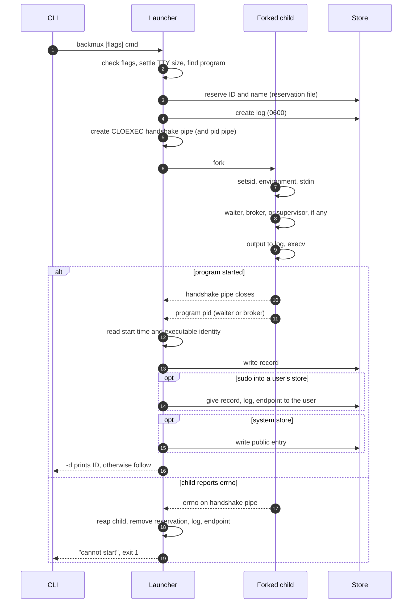
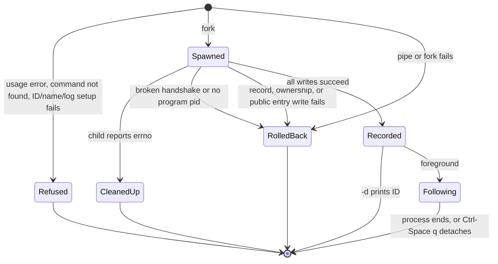

# Launcher

[Docs index](index.md) | [Previous: Index](index.md) | [Next: Store](store.md) | Related: [Identity](identity.md), [Console](console.md)

The native launch commands (`call`, `agent`, `detach`, `server`, and `shell`)
and the flag form `backmux [flags] <cmd> [args...]` start managed processes. The launcher reserves a process ID, creates the log, forks, confirms the program started, and writes the record. Then it either prints the ID and returns (`-d`) or stays in the foreground.

Every managed process starts in a separate session and process group.
Detaching or losing the terminal leaves it running; SIGTERM sent to an
attached launch is forwarded to its program. `-d` selects a detached launch.

## Launch modes and output

- **Detached server (`server`, `-d`):** print the full Backmux process ID on
  stdout. The process name is reported on stderr unless `--quiet` is set.
  A plain server writes directly to its log and has no console.
- **Attached terminal (`call`, `agent`, bare program, `-it`):** run on a PTY
  and attach to its output. On a real terminal, pane and chat controls are
  available through the attach client. Otherwise the launch streams output.
  The foreground command returns the program's exit status when it exits.
- **Detached terminal (`detach`, `-dt`):** start a PTY process and print its
  Backmux process ID. `attach`, `peek`, and `send` can access it later.
- **Pipe-input process (`-i` without `-t`):** a broker owns the program's
  input pipe. Interactive input is line-edited; Ctrl-D on an empty line
  closes input. Piped input is streamed and its EOF closes program input.
- **Plain foreground process (`-w`, active `--restart`, `--tail PROGRAM`):**
  follow the log and return the program's exit status. No PTY is allocated.

Every message to a process arrives behind a sender and reply-command
header, whoever sent it. Why one format: whoever reads a message, person or
agent, needs to know who wrote it and how to answer, and a setting chosen at
launch to get that was one more thing to know. `backmux send` types text as
it is. Chat uses a separate inbox identity.

Ctrl-C is forwarded while attached or following a launch. Ctrl-Space q
detaches the active pane. In a standalone log-follow command (`tail` or
`logs -f`), Ctrl-C only stops following. See [Console](console.md).

## The program

Backmux looks the program up on `PATH` and runs it with `execv`. It never wraps the command in a shell, so a missing command fails before anything is created. Shell snippets go through `backmux -- sh -c '…'`.

The path is made absolute, but symlinks are not resolved, because a venv's python or a multi-process binary finds its environment through the name it was run under. The arguments are passed exactly as typed: a word that happens to name a file stays that word. The exception is a launch under sudo, where the program starts in `/`: there, arguments that name existing paths are made absolute, so `./script` still names the caller's file. The record keeps the argv as typed in `observed.argv` ([Store](store.md)).

The environment:

- Every process gets `BACKMUX_ID`, and `BACKMUX_NAME` when it has a name. A process placed from inside another process also gets `BACKMUX_PARENT`, the launcher's ID (its name only when it has no ID), so a worker given its task on the command line, with no message header to reply to, can report back. The ID because a name can be renamed or reused after a purge; `backmux help` shows the parent's current name as "Started by".
- A terminal process runs on Backmux's own terminal, so it gets `TERM=xterm-256color`, and `TMUX`, `TMUX_PANE`, `STY`, `WINDOW`, `TERM_PROGRAM`, and `TERM_PROGRAM_VERSION` are removed. Otherwise a program that sees `TMUX` would act on the launcher's tmux. `-e` values are applied after this, so they win.
- A root process in the system store starts from an empty environment with a fixed `PATH`.
- Under sudo, the program starts in `/`. The launch is refused if `/` is not root-owned or is group- or world-writable.

## Process supervision

| Start | Process left with the program | Exit code recorded |
|---|---|---|
| `-d` | none | no |
| `-w`, `--rm`, a plain foreground process (without `-t` or `-i`) | a waiter in its own session | yes |
| `-i` without `-t` or an active restart policy | the console broker, which holds the program's input pipe | yes |
| Active `--restart POLICY` | a supervisor that reruns the program | yes |
| `-t`, `call`, `agent`, `detach`, `shell`, and bare terminal launches | the console broker, which owns the PTY | yes |

The waiter starts a separate session before forking the program. Ending
the caller's process group therefore does not also terminate the waiter.

The record's `pid`, `pgid`, and `sid` are the program's own, which the waiter or broker reports back. With `--restart` they are the supervisor's; each rerun stays in its process group. `--restart` with `-t` is refused.

Between restarts the supervisor waits `--restart-delay` seconds when it was given (0 included). Without it, it backs off: 1 s, doubling to 30 s, and back to 1 s after a run of 10 s or more. Without a backoff, a program that fails at once restarts in a tight loop (forever under `always`), burning CPU and flooding its log; Docker backs off for the same reason. Only an explicit delay is recorded; a recall reuses it or applies the default backoff.

## Launch sequence

The TTY size is settled before anything is created, so an unusable size starts nothing. The order is:

1. `--size`
2. the size recorded for a recalled process
3. for a detached process, the saved `detach-size`
4. the invoking terminal
5. 80×24

The launcher reads the terminal size itself because the broker runs with `/dev/null` stdio and cannot ask a terminal.

The parent reads the program's start time and executable identity before writing the record. A leader that exits at once, while its group lives on (`sh -c 'worker & exit'`), leaves nothing to read a moment later.

## Handshake

Before the fork, the parent creates a close-on-exec pipe. If any step before exec fails, the child writes `errno` to the pipe and exits 127. The steps are: setsid, the `/` working directory, the environment, stdin, the log, the waiter's fork, broker or PTY setup, and `execv`.

On success the pipe closes:

- at exec, for a plain or waiter process
- after the PTY spawn, for a terminal process
- before the first run, for `--restart`, so a restart's own exec failures appear in the log, not at launch

`hold_read_exec_handshake` returns 0 for success, 1 with the child's errno, or −1 for a broken handshake. A failed initial exec handshake is rolled back instead of being retained
as a successful launch. Restart-supervised launches have the earlier
handshake described above. A command that could not be started exits as a shell's would: 127 when there is no such command, 126 when it is there but cannot be run (not executable, a directory) - the codes scripts, CI runners, and `docker run` already read that way.

## Rollback

Every failure after the reservation goes through `launch_undo`. It SIGKILLs the spawned group, kills a separate supervisor or broker, and removes the new record, reservation, new log, console endpoint, and any partial public entry. A failed relaunch retains the existing record and log. All-or-nothing matters most in the system store: a root process that normal users cannot discover would break public discovery.

## Logs and following

A plain process (no `-t`, no `-i`) has stdin on `/dev/null`, and its stdout and stderr go straight into `<id>.log`, with no copying process in between. With `-t`, the broker copies PTY output into the same log while also feeding its screen. With `-i`, the program's stdin is a pipe the broker holds and its output a pipe the broker copies into the log and the screen (with `\n` read as `\r\n`, as a PTY would), so console-backed processes support screen commands as well as log access.
Plain processes have logs and exit waits, but no screen for `peek` or
screen-based wait conditions.

The launcher restores the default SIGINT and SIGQUIT dispositions before
starting the program. This prevents ignored signal dispositions inherited
from a background shell launch from disabling the program's normal
interrupt handling. The program can subsequently install its own handlers.

A plain foreground start writes the record first, then follows the log from its beginning (`hold_follow_launched_call`, on the one client loop in `console/client.c`). At a terminal, keys are read one at a time with output untouched: Ctrl-C is passed to the program after the same identity checks as `backmux end`, and Ctrl-Space q stops following and leaves it running. Without a terminal, a SIGINT sent to backmux is passed on, as `docker run`'s sig-proxy does. The log is polled every 100 ms; about once a second backmux checks whether the process still runs, and when it ends it drains the log once more.

An attached launch forwards SIGTERM to its program. This requests
termination; the program can handle or ignore the signal. A terminal
hangup (SIGHUP) detaches instead. If its output reader closes, as in
`backmux PROGRAM | head`, Backmux reports that the process remains running
and exits with status 141. Each run records its starting offset in the
shared log (`log_start`), so a process that exits before attach completes
still has only the current run's output printed.

With `--rm`, a foreground start removes the process when it ends. If you detach while the process runs, a watcher removes it later.

## Recall and target shorthand

`backmux recall NAME` relaunches a stopped process and rejects a process
confirmed to be running. An unknown state is not rejected by that initial
check; subsequent identity checks still apply.
The shorthand `backmux <id|name>` can also relaunch a stored process, or
reconnect to one that is running. It is resolved only for a single word,
with no `--` and no `--name`. The word matches by ID prefix or by name, in your own store first, then (as root) in the system store. A word that is none of these, and no program on PATH either, may be the start of exactly one process's name or verb (`backmux hel` for helper, `backmux li` for list); several fits are listed and nothing runs (exit 6). That order keeps every word that meant something before meaning the same thing.

Recall reuses the stored executable, arguments, environment overrides,
working directory, launch mode, terminal size, restart policy, and name.

A terminal is rebuilt from its last observed state (`terminal` in the
record, [Store](store.md)), because a saved terminal is the person's work,
not its launch line: a hosting shell starts in the directory last observed
(its cds are the person's navigation) and gets typed at its prompt its environment source (`set NAME
source=FILE`, sourced with `.`, or `source` in fish) and the workload it was
running, with its exact argv (single-quoted for the shell), through `sh -c
'cd "$1" && shift && exec "$@"'` when the workload's directory differs, so
the shell's own directory stays put. The broker types it once the shell's
line editor takes the terminal out of canonical mode, or after 1.5 s for a
shell that never does: input typed ahead in canonical mode is cut at the line
discipline's limit. Each typed line starts with a space, which bash, zsh and
fish keep out of the history. Not rebuilt, and said on stderr: a pipeline,
an argument holding a control character, and anything for csh. A program
launched directly is relaunched as launched, where it was launched (its
arguments, passed as typed, are relative to that directory). The
last observation stays in the record until the new run is observed.
It retains the Backmux process ID and appends to the same log. Explicit
mode flags on the bare target shorthand can override the stored launch
mode. A recalled `shell` still requires an interactive terminal.

For a running process, the bare target shorthand attaches to its console
or follows its log if it has no console. An explicit `-d` prints its
Backmux process ID without attaching. This differs from `recall NAME`,
which rejects a process confirmed to be running.

## Implementation map

`hold_perform_start_options`, `child_session_setup`, `run_restart_supervisor`, `launch_undo`, `launch_die`, `hold_ensure_start_store_for_command` (src/runtime/start.c); `hold_read_exec_handshake` (src/core/util.c); `hold_run_console_broker` (src/console/broker.c); `hold_rollback_spawned_group` (src/runtime/state.c); `hold_tail_log_until_exit` (src/runtime/signal.c); `hold_write_record_atomic` (src/store/record.c); `hold_cmd_redial`, `restart_existing_run` (src/runtime/call.c);
`hold_cmd_recall_action` (src/runtime/settings.c).

## Continue

[Back to docs index](index.md) | [Top](#launcher) | [Next: Store](store.md) | Branch to: [Console](console.md), [Identity](identity.md)
