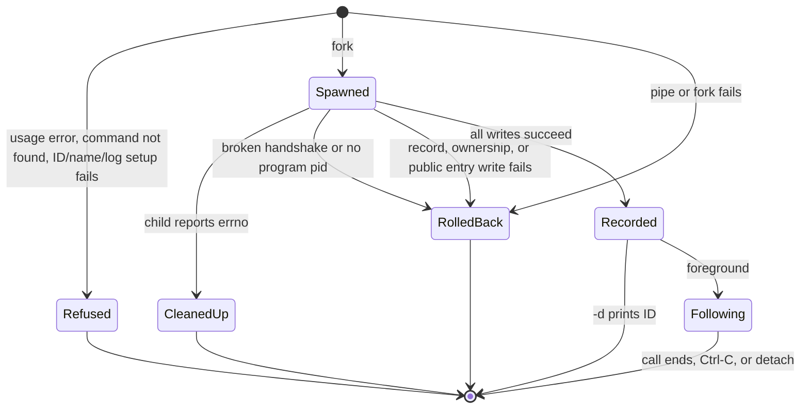

# Launcher

[Docs index](index.md) | [Previous: Index](index.md) | [Next: Store](store.md) | Related: [Identity](identity.md), [Console](console.md)

`callbox [flags] <cmd> [args...]` places a call. The launcher reserves a call ID, creates the log, forks, confirms the program started, and writes the record. Then it either prints the ID and returns (`-d`) or stays in the foreground.

Every call runs in its own session, so it outlives the shell that started it either way. `-d` decides only whether callbox returns at once.

## Output

- **`-d`:** prints the bare 64-hex call ID on stdout and nothing else.
- **Foreground, no `-t`:** prints nothing of its own. It streams the log, then exits with the call's exit status. Ctrl-C stops the stream and leaves the call running (exit 0).
- **Foreground with `-t`:** attaches to the call's screen. Ctrl-P Ctrl-Q detaches and leaves the call running.

This is `docker run`'s output dialect ([Docker parity](docker-familiarity-contract.md)).

## The program

Callbox looks the program up on `PATH` and runs it with `execv`. It never wraps the command in a shell, so a missing command fails before anything is created. Shell snippets go through `callbox -- sh -c '…'`.

The path is made absolute, but symlinks are not resolved, because a venv's python or a multi-call binary finds its environment through the name it was run under. Arguments that name existing paths are also made absolute. The record keeps the argv as typed in `observed.argv` ([Store](store.md)).

The environment:

- Every call gets `CALLBOX_ID`, and `CALLBOX_NAME` when it has a name. A call placed from inside another call also gets `CALLBOX_PARENT`, so a worker can reply to the agent that started it.
- A TTY call runs on callbox's own terminal, so it gets `TERM=xterm-256color`, and `TMUX`, `TMUX_PANE`, `STY`, `WINDOW`, `TERM_PROGRAM`, and `TERM_PROGRAM_VERSION` are removed. Otherwise a program that sees `TMUX` would act on the launcher's tmux. `-e` values are applied after this, so they win.
- A root call in the system store starts from an empty environment with a fixed `PATH`.
- Under sudo, the program starts in `/`. The launch is refused if `/` is not root-owned or is group- or world-writable.

## Who supervises the call

| Start | Process left with the program | Exit code recorded |
|---|---|---|
| `-d` | none | no |
| foreground, `-w`, `--rm` (without `-t`) | a waiter in its own session | yes |
| `--restart POLICY` | a supervisor that reruns the program | yes |
| `-t` | the console broker, which owns the PTY | yes |

The waiter takes its own session before it forks the program. That way, killing the caller's process group cannot leave the exit unrecorded.

The record's `pid`, `pgid`, and `sid` are the program's own, which the waiter or broker reports back. With `--restart` they are the supervisor's; each rerun stays in its process group. `--restart` with `-t` is refused.

## Launch sequence

The TTY size is settled before anything is created, so an unusable size starts nothing. The order is:

1. `--size`
2. the size a redialed recipe was placed with
3. for a detached call, the saved `detach-size`
4. the invoking terminal
5. 80×24

The launcher reads the terminal size itself because the broker runs with `/dev/null` stdio and cannot ask a terminal.

The parent reads the program's start time and executable identity before writing the record. A leader that exits at once, while its group lives on (`sh -c 'worker & exit'`), leaves nothing to read a moment later.

## Handshake

Before the fork, the parent creates a close-on-exec pipe. If any step before exec fails, the child writes `errno` to the pipe and exits 127. The steps are: setsid, the `/` working directory, the environment, stdin, the log, the waiter's fork, broker or PTY setup, and `execv`.

On success the pipe closes:

- at exec, for a plain or waiter call
- after the PTY spawn, for a TTY call
- before the first run, for `--restart`, so a restart's own exec failures appear in the log, not at launch

`hold_read_exec_handshake` returns 0 for success, 1 with the child's errno, or −1 for a broken handshake. Callbox never records a call that did not start.

## Rollback

Every failure after the reservation goes through `launch_undo`. It SIGKILLs the spawned group, kills a separate supervisor or broker, and removes the new record, reservation, new log, console endpoint, and any partial public entry. A redial keeps its existing record and log. All-or-nothing matters most in the system store: a root call that normal users cannot discover would break public discovery.

## Logs and following

Without `-t`, stdin is `/dev/null` unless `-i` is given, and stdout and stderr go straight into `<id>.log`, with no copying process in between. With `-t`, the broker copies PTY output into the same log while also feeding its screen, so `logs` and `tail` behave the same for both.

A foreground start writes the record first, then follows the log from its beginning with `hold_tail_log_until_exit`. That function opens the log with `O_NOFOLLOW` and polls every 100 ms. About once a second it checks whether the call still runs; when the call ends, it drains the log once more.

With `--rm`, a foreground start removes the call when it ends. If you detach or interrupt while the call runs, a watcher removes it later.

## Redial

`callbox <id|name>` places a recorded call again. Redial happens only when the command is a single word, with no `--` and no `--name`. The word matches by ID prefix or by name, in your own store first, then (as root) in the system store.

The redial runs the recorded recipe under the same call ID and appends to the same log. It reuses the recorded argv, environment, mode, size, restart policy, and name. A redial runs in the mode the call first ran in, unless it names a mode itself. A `callbox shell` call comes back as a shell. A call that is still running is refused (exit 6), as is an ambiguous word.

## Implementation map

`hold_perform_start_options`, `child_session_setup`, `run_restart_supervisor`, `launch_undo`, `launch_die`, `hold_ensure_start_store_for_command` (src/runtime/start.c); `hold_read_exec_handshake` (src/core/util.c); `hold_run_console_broker` (src/console/broker.c); `hold_rollback_spawned_group` (src/runtime/state.c); `hold_tail_log_until_exit` (src/runtime/signal.c); `hold_write_record_atomic` (src/store/record.c); `hold_cmd_redial`, `restart_existing_run` (src/runtime/call.c).

## Continue

[Back to docs index](index.md) | [Top](#launcher) | [Next: Store](store.md) | Branch to: [Console](console.md), [Identity](identity.md)
