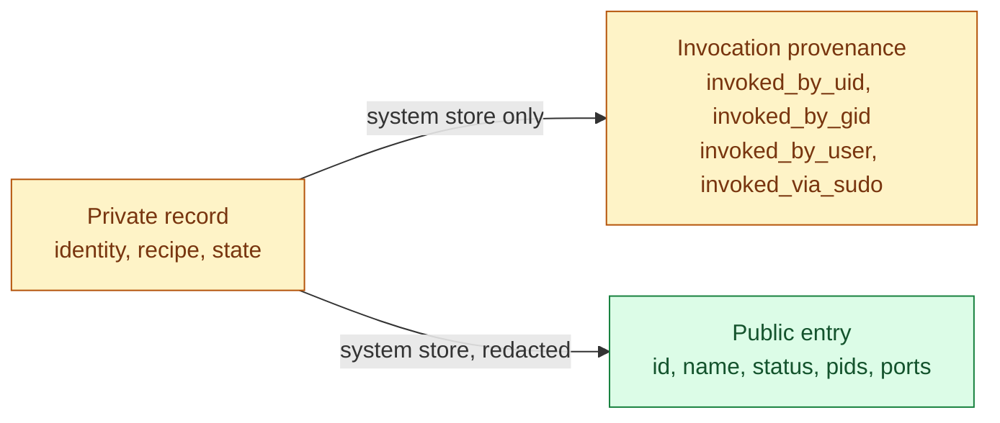
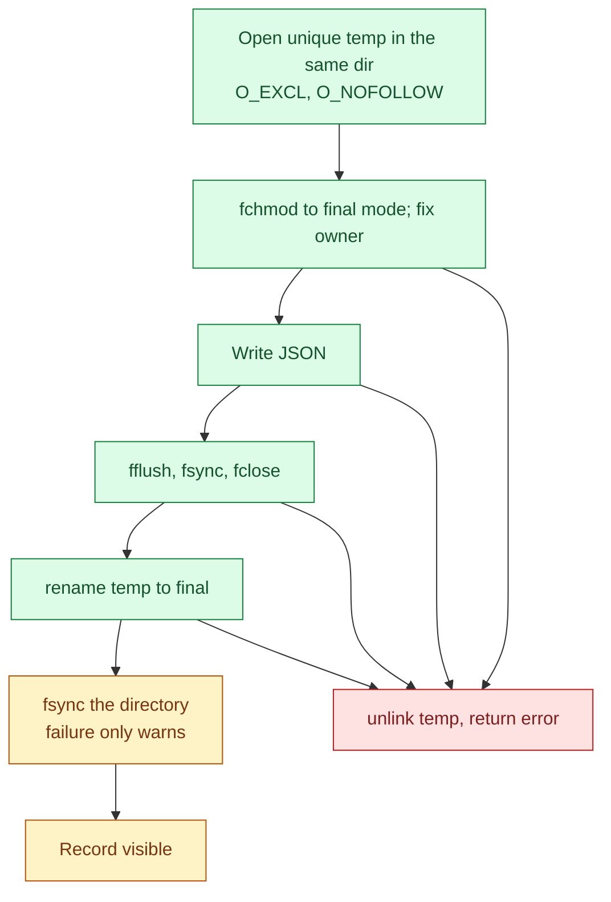

# Store

[Docs index](index.md) | [Previous: Launcher](launcher.md) | [Next: Identity](identity.md) | Related: [Console](console.md), [Screen](screen.md)

The store holds what later commands need: call records, logs, saved screens, message logs, console endpoints, and the public discovery entries for root-managed calls. `backmux logs <call>` and `backmux end <call>` work after the original shell is gone because this state is on disk.

Backmux has no daemon. Every command reads its intent from these files, then checks the live process table separately ([Identity](identity.md)).

## Which store

There are two stores:

- The user store, for normal starts.
- The system store, for starts as root, under sudo, or with `--system`. `--system` needs root; a normal user who asks for it is refused (exit 3).

One exception: when a root or sudo start names a program, or an existing path argument, under the invoking user's home, the call goes into that user's own store and is owned by that user, because that user started it: people keep track of the programs they start in their own store, and look for them there.

## Layouts

The user store is one flat directory:

```text
~/.local/state/backmux/          0700
  <id>.json                      the record (0600)
  <id>.log                       the output (0600)
  <id>.screen, <id>.altscreen    a TTY call's last screens
  <id>.msgs                      a TTY call's message log
  .<id>.reserve                  present only while a call is being created
  .<id>.exit.tmp                 an --rm call's exit note
  console/                       0700
    <id>.sock                    a TTY call's console endpoint
```

`hold_ensure_user_store_for_current_user` creates the base and `console/` as `0700`, or sets an existing one to `0700`, and refuses symlinks. Under sudo, `hold_ensure_invoking_user_store` sets `~/.local`, `~/.local/state`, the base, and `console/` to `0700` and gives them to the invoking user.

The system store is split by kind:

```text
/var/lib/backmux (Linux), /var/db/backmux (macOS)   0755 root
  runs/      0700 root   <id>.json (0600), .<id>.reserve, .<id>.exit.tmp
  logs/      0700 root   <id>.log, <id>.screen, <id>.altscreen, <id>.msgs (0600)
  console/   0700 root   <id>.sock
  public/    0755 root   <id>.json (0644, root:root)
```

Only `public/` is readable by everyone. The private records, logs, and endpoints carry root's command lines, environment, and output, so they stay in `0700` root directories.

A build can set `HOLD_SYSTEM_STATE_DIR` at compile time. Test builds also read `HOLD_TEST_SYSTEM_STATE_DIR`. Production builds take no environment override for the system store.

## Settings

A person's saved defaults are not call state, so they live outside the store, in `~/.config/backmux/config` (0600). The file is plain text, one `name value` line per setting. `backmux config set` / `unset` rewrite it through a temp file and a rename, so a reader never sees half a file. Lines backmux does not know, such as comments or a newer version's settings, are kept as they are. A symlinked `~/.config`, `backmux` directory, or file is followed, because dotfile managers make all three.

Under `sudo`, a launch reads the invoking user's file, and `backmux config set` / `unset` are refused: settings are changed as the person they belong to, never by root writing into their home. One setting exists: `detach-size COLS ROWS`, the size a detached TTY call starts at when no `--size` is given.

## Call IDs

A call ID is 64 hex characters: a SHA-256 over a version tag, the executable path, the working directory, the start time in nanoseconds, the launcher's pid, the argv, and a counter. The launcher skips any candidate that already has a record, log, reservation, console endpoint, or public entry. It claims the first free one by creating `.<id>.reserve` with `O_EXCL`. It tries at most 1024 counters.

The name is written into the reservation under the store lock. A call mid-launch has no record yet, so this is how a second launch sees that the name is taken. A reservation older than 600 seconds is treated as left over from a dead start. Writing the record removes the reservation.

## Records



`hold_write_record_atomic` writes one private JSON record per call. A single field table (`hold_record_fields`, src/store/record.c) drives both the writer and the reader.

- **Required on read:** `version`, `id`, `pid`, `pgid`, `sid`, `uid`, `gid`, `proc_starttime_ticks`, `exe_dev`, `exe_ino`. The reader refuses a record without them. The identity values are 0 when a probe failed at launch.
- **Always written:** `saved`, `auto_remove`, `pid_ns`, `liveness_lock`, `run_id`, `start_unix_ns`, `created_unix_ns`. The reader defaults `run_id` from `id` and `created_unix_ns` from `start_unix_ns`.
- **Written when set:** `name`, `started_at`, `created_at`, `ended_at`, `state`, `exit_code`, `term_signal`, `launch_error`, `console_sock`, `broker_pid`, `log_path`, `boot_id`, `size_cols`/`size_rows`, `chat_key`, `lead_key`, `detach_key`, `restart`, `restart_delay_seconds`, and the provenance fields.
- **Structured:** `argv`, `normalized.argv`, `observed` (`exe`, `argv`, `cwd`), `env` (only when not empty), and `mode` (`interactive`, `tty`, `detach`, `wait`, `allow_multi`, `chat`).

The recorded `argv` is the recipe a redial runs again ([Launcher](launcher.md)). `argv[0]` is the program's absolute path as named, with symlinks not resolved, because a venv's python or a multi-call binary finds its environment through that name. Later arguments that name existing paths are made absolute. `observed.argv` keeps the argv as typed, and `observed.exe` the resolved real executable.

### Exit stamp

`hold_mark_run_finished` records an ended call. It sets `state` to `exited`, `exit_code` (128 + the signal number when a signal ended it), `term_signal`, and `ended_at`, then rewrites the public entry with no ports. It runs under the store lock:

- If the record is gone, a purge removed it, and the stamp does not recreate it.
- It re-reads `saved` and `name` before writing, so a concurrent `save` or `rename` is not lost.

Waiters, restart supervisors, and TTY brokers stamp exits. A plain `-d` call has none of these, so its record keeps `state: running` after it ends. Commands still judge it from the process table ([Identity](identity.md)).

## Public entries

`hold_write_public_index_atomic` writes a redacted view of each system-store call to `public/<id>.json`, mode `0644`, owned root:root. Fields: `id`, `root_managed`, optional `name`, `state_hint`, `started_at`, `created_at`, optional `observed_ports`, `ended_at`, `exit_code`, `pid`, `pgid`, `sid`, and `running`. It never contains argv, environment, log or endpoint paths, boot ID, executable identity, or provenance. An absent `observed_ports` means not observed yet, not "no ports".

## Atomic writes



`hold_atomic_write_json` is the only commit path for records and public entries.

- **Temp name:** `.<id>.json.<pid>.<nonce><counter>.tmp`, in the destination directory.
- **Mode:** `fchmod` sets the final mode, so the umask cannot change it.
- **Public entries:** root gives them to root:root.
- **Root writing a user's store (sudo):** the temp takes the owner of the file it replaces, or of the directory for a new file, before the rename. It is never root-owned, even briefly.
- **Directory fsync:** runs after the rename. A failure there only warns, because the record is already complete.

Without a daemon, a later command cannot repair a half-written record. With this write path, a record either loads whole or does not exist.

## Store lock

`hold_store_lock` takes an exclusive `flock` on the record directory. It is held only around short critical sections and never nested:

- the exit stamp
- purge and the purge sweep
- `save` and `rename`
- name reservation
- root's refresh of public ports

It keeps a purged record gone and stops concurrent rewrites from losing each other's changes. If the lock cannot be taken, callers proceed unlocked.

## Public and private authority

Private records are authoritative. Public entries let normal users see that a root-managed call exists, with its name, status, pids, and ports. They never say who owns it. Acting on such a call needs root.

What each view reads:

- A normal user's `list` reads their own store.
- `list -s` reads the public entries.
- `list -a` reads both.
- `ps` always reads both.
- Root's `list` reads the private system records, after refreshing each running call's `observed_ports`.
- Root's `list -a` also reads every user store under `/home`.

A plain `-d` call's public entry keeps `state_hint: running` after it ends, because no process stamps its exit. So `list` decides whether a global call runs from its process group's live members, which anyone can see. It uses the hint only when there is no group to check or the process table cannot be read. Root actions always reload the private record and validate the live process before signaling or purging.

## Purge

`backmux purge` (aliases `rm`, `prune`, `drop`) is the removal verb.

A targeted purge (`hold_prune_one_run_ex`) works by state:

| State | Purged? |
|---|---|
| exited, failed, stale | yes |
| unknown | only with `--force` |
| running | only with `--force`, which ends the call first (TERM, then KILL) |
| saved, any state | only with `--force` |

The no-target sweep (`cmd_prune_store_all`):

- removes ended calls; stale calls too with `-a`
- keeps saved and running calls, and reports what it kept
- deletes records it cannot parse
- removes logs, screens, message logs, console endpoints, and public entries whose record is gone, unless a reservation under 600 seconds old shows a launch in progress
- removes dot-`.tmp` files older than 60 seconds; the age gate protects a writer that is still running

Purge deletes only paths it derives from the store layout and the call ID, never a path read from a record. Each removal holds the store lock, so a racing exit stamp cannot recreate the record. When an `--rm` call is purged after its exit was recorded, purge writes the `.<id>.exit.tmp` note (exit code and name) that `backmux wait` reads.

## Implementation map

`struct hold_store`, `struct hold_run_record`, `struct hold_public_index` (include/backmux/types.h); `hold_init_user_store_from_home`, `hold_ensure_user_store_for_current_user`, `hold_ensure_invoking_user_store`, `hold_init_system_store`, `hold_ensure_system_store` (src/store/layout.c); `hold_reserve_run_id`, `hold_mark_run_finished` (src/store/lifecycle.c); `hold_record_fields`, `hold_write_record_atomic` (src/store/record.c); `hold_load_record` (src/store/record_read.c); `hold_write_public_index_atomic`, `hold_load_public_index` (src/store/public_index.c); `hold_atomic_write_json`, `hold_store_lock` (src/store/atomic.c); `hold_resolve_record_id` (src/store/resolve.c); `hold_prune_one_run_ex`, `cmd_prune_store_all` (src/runtime/list.c).

## Continue

[Back to docs index](index.md) | [Top](#store) | [Next: Identity](identity.md)
