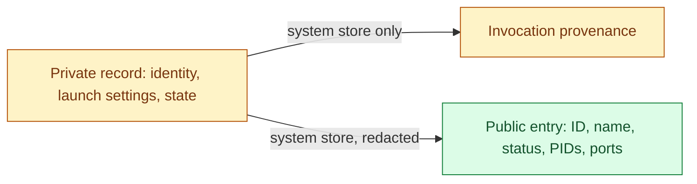
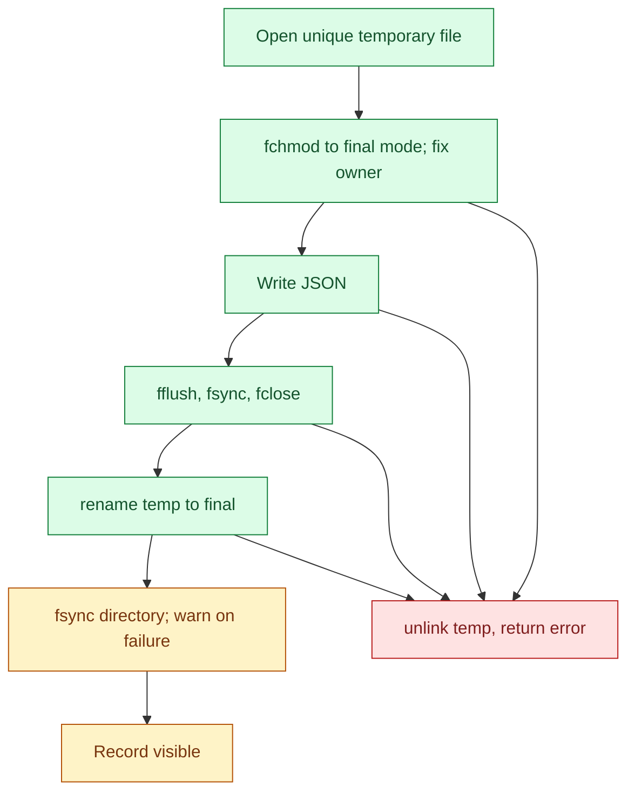

# Store

[Docs index](index.md) | [Previous: Launcher](launcher.md) | [Next: Identity](identity.md) | Related: [Console](console.md), [Screen](screen.md)

The store holds what later commands need: process records, logs, saved screens, message logs, console endpoints, and the public discovery entries for root-managed processes. `backmux logs <process>` and `backmux end <process>` work after the original shell is gone because this state is on disk.

Backmux has no central daemon. Every command reads its intent from these files, then checks the live process table separately ([Identity](identity.md)).

## Which store

There are two stores:

- The user store, for normal starts.
- The system store, for starts as root, under sudo, or with `--system`. `--system` needs root; a normal user who asks for it is refused (exit 3).

One exception: when a root or sudo start names a program, or an existing path argument, under the invoking user's home, the process goes into that user's own store and its record and log are owned by that user. Store placement does not
drop the program's root privileges.

## Layouts

Process records and logs sit directly under the user-store directory:

```text
~/.local/state/backmux/          0700
  <id>.json                      the record (0600)
  <id>.log                       the output (0600)
  <id>.screen, <id>.altscreen    a terminal process's last screens
  <id>.msgs                      a console-backed process's message log
  .<id>.reserve                  present only while a process is being created
  .<id>.exit.tmp                 an --rm process's exit note
  inbox/                        named inboxes for outside senders
  chat/                         conversation logs and compositor coordination
  console/                       0700
    <id>.sock                    a console-backed process's endpoint
```

`hold_ensure_user_store_for_current_user` creates the base and `console/` as `0700`, or sets an existing one to `0700`, and refuses symlinks. Under sudo, `hold_ensure_invoking_user_store` sets `~/.local`, `~/.local/state`, the base, and `console/` to `0700` and gives them to the invoking user.

The system store is split by kind:

```text
/var/lib/backmux (Linux), /var/db/backmux (macOS)   0755 root
  runs/      0700 root   <id>.json (0600), .<id>.reserve, .<id>.exit.tmp
  logs/      0700 root   <id>.log, <id>.screen, <id>.altscreen, <id>.msgs (0600)
  console/   0700 root   <id>.sock
  public/    0755 root   <id>.json (0644, root:root)
```

Only `public/` is readable by everyone. The private records, logs, and endpoints carry root's command lines, environment, and output, so they stay in `0700` root directories.

A build can set `HOLD_SYSTEM_STATE_DIR` at compile time. Test builds also read `HOLD_TEST_SYSTEM_STATE_DIR`. Production builds take no environment override for the system store.

## Settings

A person's saved defaults are not process state, so they live outside the store, in `~/.config/backmux/config` (0600). The file is plain text, one `name value` line per setting. `backmux config set` / `unset` rewrite it through a temp file and a rename, so a reader never sees half a file. Lines backmux does not know, such as comments or a newer version's settings, are kept as they are. A symlinked `~/.config`, `backmux` directory, or file is followed, because dotfile managers make all three.

Under `sudo`, a launch reads the invoking user's file, and `backmux config set` / `unset` are refused: settings are changed as the person they belong to, never by root writing into their home. Two settings are supported:

- `detach-size COLS ROWS`: initial size for detached terminal launches
  without an explicit `--size`.
- `chat-name NAME`: preferred name when creating the person's chat inbox.
  It does not rename an existing live inbox.

## Process IDs

A Backmux process ID is 64 hexadecimal characters: a SHA-256 over a version tag, the executable path, the working directory, the start time in nanoseconds, the launcher's pid, the argv, and a counter. The launcher skips any candidate that already has a record, log, reservation, console endpoint, or public entry. It claims the first free one by creating `.<id>.reserve` with `O_EXCL`. It tries at most 1024 counters.

The name is written into the reservation under the store lock. A process mid-launch has no record yet, so this is how a second launch sees that the name is taken. A reservation older than 600 seconds is treated as left over from a dead start. Writing the record removes the reservation.

## Records



`hold_write_record_atomic` writes one private JSON record per process. A single field table (`hold_record_fields`, src/store/record.c) drives both the writer and the reader.

- **Required on read:** `version`, `id`, `pid`, `pgid`, `sid`, `uid`, `gid`, `proc_starttime_ticks`, `exe_dev`, `exe_ino`. The reader refuses a record without them. The identity values are 0 when a probe failed at launch.
- **Always written:** `saved`, `auto_remove`, `pid_ns`, `liveness_lock`, `log_start`, `agent`, `run_id`, `start_unix_ns`, `created_unix_ns`. The reader defaults `run_id` from `id` and `created_unix_ns` from `start_unix_ns`.
- **Written when set:** `name`, `working`, `started_at`, `created_at`, `ended_at`, `state`, `exit_code`, `term_signal`, `launch_error`, `console_sock`, `broker_pid`, `log_path`, `boot_id`, `size_cols`/`size_rows`, `chat_key`, `lead_key`, `detach_key`, `restart`, `restart_delay_seconds`, and the provenance fields.
- **Structured:** `argv`, `normalized.argv`, `observed` (`exe`, `argv`, `cwd`), `env` (only when not empty), and `mode` (`interactive`, `tty`, `detach`, `wait`, `allow_multi`, `chat`, `shell`).

`mode.chat` and its key fields support the retained broker-chat path. Current
launch commands use the attach-client compositor and do not enable that mode.

The recorded `argv` supplies the executable and arguments used by recall ([Launcher](launcher.md)). `argv[0]` is the program's absolute path as named, with symlinks not resolved, because a venv's python or a multi-process binary finds its environment through that name. Later arguments that name existing paths are made absolute. `observed.argv` keeps the argv as typed, and `observed.exe` the resolved real executable.

### Terminal state

A terminal process's record also carries `terminal`: what the terminal was
doing when last observed. Why: the launch says how a terminal started, but
the person then changes directory and runs programs in it, so a saved
terminal rebuilt from its launch alone is not the one they saved (a bash
launched in `~` that is running claude in `~/callbox` is "bash in `~`" by its
launch). The launch fields stay as they were, as history.

| Field | Meaning |
|---|---|
| `observed_unix_ns` | When this was observed |
| `argv` | The program running now, read whole from the live process: an `exec` in place (`exec zsh`) keeps the pid but not the program, and the launch is only history |
| `hosting_shell` | That program is a shell hosting the person's commands: a known shell given no `-c` and no script, or the shell `backmux shell` started while it still runs |
| `children` | Its live child processes, background jobs included |
| `cwd` | Its current directory (the shell's, or a directly launched program's) |
| `foreground` | A hosting shell's foreground: `idle`, `workload`, `pipeline` (one argv cannot rebuild it), or `unavailable` (never read) |
| `foreground_unread` | The latest look could not read the foreground: `foreground` and `workload` are the last ones read. Why: a failed read is not evidence of idle, and must not throw away what restores the terminal. A shell read as idle does clear the workload |
| `workload` | `pid`, whole `argv` (every argument, empty ones kept) and `cwd` of the foreground job's leader, or, for a pipeline whose leader has gone, of a member still running |

It is observed from the live process tree (Linux `/proc`, macOS libproc),
never a checkpoint of process memory, and only from a process whose boot ID
and start time still match its record, so a reused PID is never read. It is
refreshed when a terminal is listed, inspected (`info`) or saved (`save`,
layout save); there is no daemon to poll. The record is rewritten only when
what the terminal does has changed, because every rewrite is an fsync and
`list` looks at every running terminal; the rewrite re-reads the record under
the store lock, so an exit stamp or a save written meanwhile is kept. Only
the store's owner rewrites it. An ended terminal keeps its last observation.
A save, or a layout save, whose terminal state could not be written fails
and says so: a reported save is a written one.
Services and pipe processes have no terminal, so no `terminal`.

### Exit stamp

`hold_mark_run_finished` records an ended process. It sets `state` to `exited`, `exit_code` (128 + the signal number when a signal ended it), `term_signal`, and `ended_at`, then rewrites the public entry with no ports. It runs under the store lock:

- If the record is gone, a purge removed it, and the stamp does not recreate it.
- It reloads the current record before applying exit fields, preserving
  concurrent profile updates when that reload succeeds.

Waiters, restart supervisors, and console brokers record exits. A plain `-d` process has none of these, so its record keeps `state: running` after it ends. Commands still judge it from the process table ([Identity](identity.md)).

## Public entries

`hold_write_public_index_atomic` writes a redacted view of each system-store process to `public/<id>.json`, mode `0644`, owned root:root. Fields: `id`, `root_managed`, optional `name`, `state_hint`, `started_at`, `created_at`, optional `observed_ports`, `ended_at`, `exit_code`, `pid`, `pgid`, `sid`, and `running`. It never contains argv, environment, log or endpoint paths, boot ID, executable identity, or provenance. An absent `observed_ports` means not observed yet, not "no ports".

## Atomic writes



`hold_atomic_write_json` is the only commit path for records and public entries.

- **Temp name:** `.<id>.json.<pid>.<nonce><counter>.tmp`, in the destination directory.
- **Mode:** `fchmod` sets the final mode, so the umask cannot change it.
- **Public entries:** root gives them to root:root.
- **Root writing a user's store (sudo):** the temp takes the owner of the file it replaces, or of the directory for a new file, before the rename. The final pathname therefore receives a file with the intended ownership.
- **Directory fsync:** runs after the rename. A failure there only warns, because the record is already complete.

Readers of the final pathname see a complete old or new record across
the rename. A failure before rename leaves the previous record in place.

## Store lock

`hold_store_lock` takes an exclusive `flock` on the record directory. It is held only around short critical sections and never nested:

- the exit stamp
- purge and the purge sweep
- `save`, `rename`, and process-setting updates
- name reservation
- root's refresh of public ports

It keeps a purged record gone and stops concurrent rewrites from losing each other's changes. If the lock cannot be taken, callers proceed unlocked.

## Public and private authority

Private records are authoritative. Public entries let normal users see that a root-managed process exists, with its name, status, pids, and ports. They never say who owns it. Acting on such a process needs root.

What each view reads:

- A normal user's `list` reads their own store.
- A normal user's `list -s` reads public entries; root reads private system records.
- `list -a` reads both.
- A normal user's `ps` reads both stores; root's `ps` reads the system store.
- Root's `list` reads the private system records, after refreshing each running process's `observed_ports`.
- Root's `list -a` also reads user stores under `/home` (`/Users` on macOS).

Store selection is independent of state filtering: `list` defaults to
running and unknown-state records, and `list all` includes stopped records.
`ps -a` includes stopped records in the `ps` view.

A plain `-d` process's public entry keeps `state_hint: running` after it ends, because no process stamps its exit. So `list` decides whether a global process runs from its process group's live members when the process table is accessible. It uses the hint only when there is no group to check or the process table cannot be read. Root actions always reload the private record and validate the live process before signaling or purging.

## Purge

`backmux purge` (aliases `prune`, `drop`) is the native sweep, and takes no
process names: removing one named process is `delete`, or the Docker-style
`rm` (src/runtime/remove.c). Why: the native workflow is to save what is worth
reusing and purge the rest, so purge is housekeeping for the whole store, not
removal of a named object.

Removing one process (`hold_prune_one_run_ex`) works by state:

| State | `delete NAME` | `rm NAME` | `rm -f NAME` |
|---|---|---|---|
| exited, failed, stale | removed | removed | removed |
| unknown | removed | refused | removed |
| running | refused (end it first) | refused | killed (SIGKILL), then removed |
| saved, any state | as above | as above | as above |

The sweep (`cmd_prune_store_all`):

- removes ended processes; stale processes too with `-a`
- keeps saved, running, and unknown-state processes
- deletes records it cannot parse
- removes logs, screens, message logs, console endpoints, and public entries whose record is gone, unless a reservation under 600 seconds old shows a launch in progress
- removes dot-`.tmp` files older than 60 seconds; the age gate protects a writer that is still running

`purge all` follows a separate runtime path: it selects unsaved records,
stops running processes, and removes eligible records. Saved profiles are
excluded. `delete NAME` removes a stopped record, including a saved profile,
and refuses a process confirmed to be running. Unknown-state records pass
that initial check; a process found running on the second check is ended
before removal (`hold_remove_target`, src/runtime/remove.c).
Neither operation saves or restores pane layouts.

Purge deletes only paths it derives from the store layout and the process ID, never a path read from a record. Each removal holds the store lock, so a racing exit stamp cannot recreate the record. When an `--rm` process is purged after its exit was recorded, purge writes the `.<id>.exit.tmp` note (exit code and name) that `backmux wait` reads.

## Implementation map

`struct hold_store`, `struct hold_run_record`, `struct hold_public_index` (include/backmux/types.h); `hold_init_user_store_from_home`, `hold_ensure_user_store_for_current_user`, `hold_ensure_invoking_user_store`, `hold_init_system_store`, `hold_ensure_system_store` (src/store/layout.c); `hold_reserve_run_id`, `hold_mark_run_finished` (src/store/lifecycle.c); `hold_record_fields`, `hold_write_record_atomic` (src/store/record.c); `hold_load_record` (src/store/record_read.c); `hold_write_public_index_atomic`, `hold_load_public_index` (src/store/public_index.c); `hold_atomic_write_json`, `hold_store_lock` (src/store/atomic.c); `hold_resolve_record_id` (src/store/resolve.c); `hold_prune_one_run_ex`, `cmd_prune_store_all` (src/runtime/list.c); `hold_cmd_set_action`,
`hold_cmd_delete_action`, `hold_cmd_purge_all_action` (src/runtime/settings.c); `hold_remove_target`, `hold_cmd_rm_action` (src/runtime/remove.c). `hold_observe_terminal`, `hold_refresh_terminal` (src/store/term_state.c).

## Continue

[Back to docs index](index.md) | [Top](#store) | [Next: Identity](identity.md)
